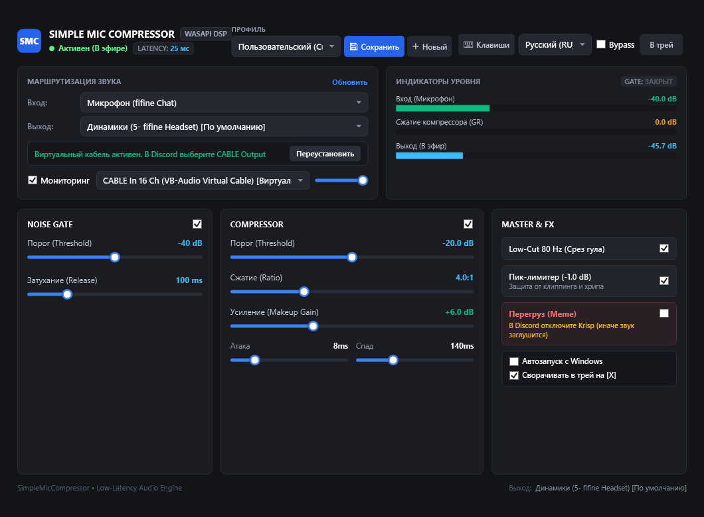
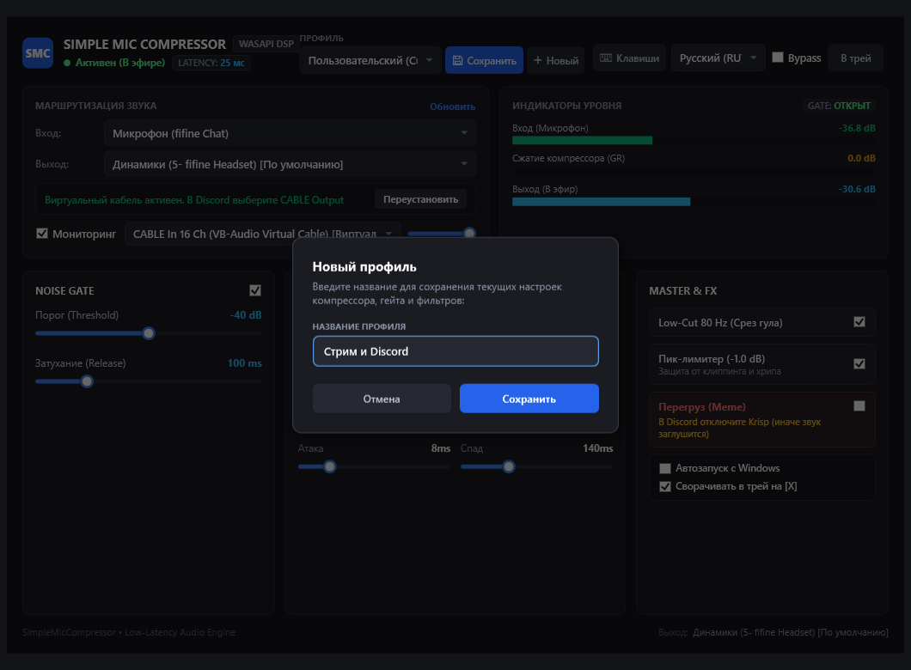
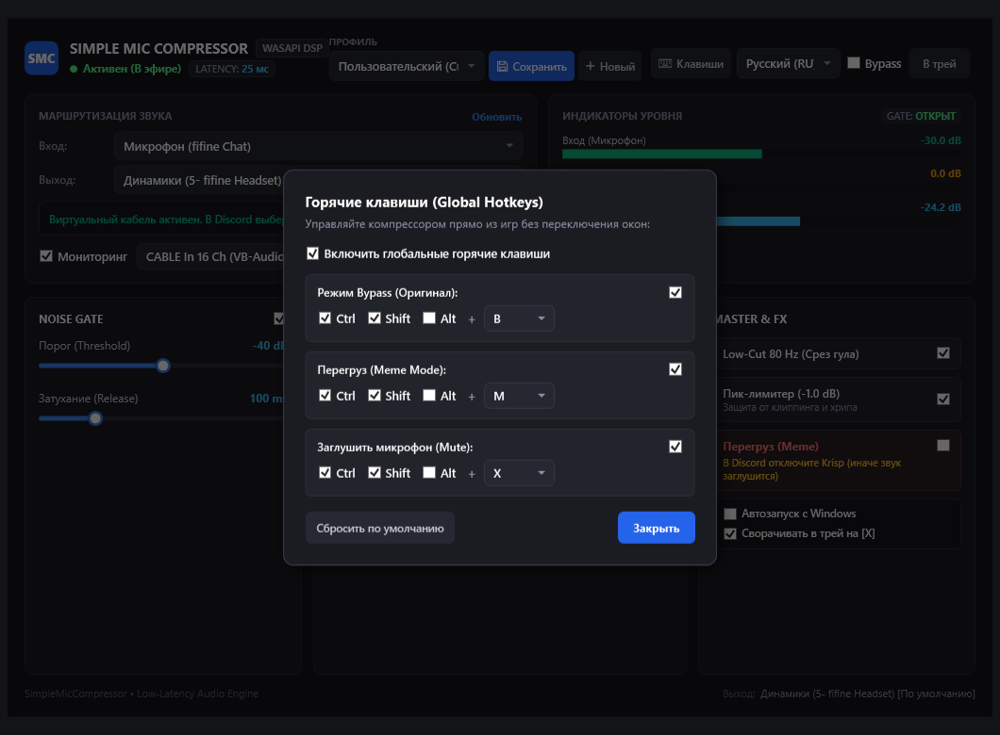

# 🎙️ SimpleMicCompressor

<p align="center">
  
</p>

<p align="center">
  
  
  
  
  
  
</p>

**SimpleMicCompressor** — легковесный, ультрабыстрый системный фоновый компрессор и процессор звука микрофона для **Discord**, **соревновательных игр** (CS2, Valorant, Apex, Warzone) и **стримов**.

Программа работает как компактный системный сервис в трее Windows, потребляет **менее 0.1% CPU** (и ровно **0.0% CPU** в свёрнутом виде), не создает нагрузку на видеокарту и гарантирует минимальную задержку звука (**~20–25 мс**), исключая микрофризы и просадки FPS.

---

## ⚡ Почему не OBS Studio или Voicemeeter?

Многие геймеры и стримеры настраивают компрессор микрофона через **OBS Studio** или **Voicemeeter Banana**. Ниже наглядно показано, почему отдельный легковесный компрессор на WASAPI значительно эффективнее:

| Параметр | OBS Studio (как компрессор) | Voicemeeter | SimpleMicCompressor |
| :--- | :--- | :--- | :--- |
| **Потребление ОЗУ (RAM)** | ~400 – 750 МБ | ~70 – 120 МБ | **~18 – 25 МБ** *(в 30 раз меньше)* |
| **Нагрузка на CPU / GPU** | 1.5 – 5% CPU + рендер кадров на GPU | 0.5 – 2% CPU | **< 0.1% CPU (0.0% в трее, 0% GPU)** |
| **Сквозная задержка (Latency)**| 40 – 110+ мс *(рассинхрон с видео)* | 25 – 45 мс | **20 – 25 мс** *(не ощущается на слух)* |
| **Влияние на 1% Low FPS в играх**| Может вызывать микрофризы и статтеры | Минимальное | **Полностью отсутствует (0% влияния)** |
| **Сложность настройки** | Сложные матрицы и видеосцены | Запутанный интерфейс | **Готово за 1 минуту, встроенные пресеты** |
| **Установка виртуального кабеля**| Вручную искать и распаковывать | Требует ручной установки | **1 клик прямо из окна приложения** |
| **Восстановление USB микрофона**| Часто требует перезапуска | Часто зависает при выключении | **Авторекавери (Watchdog) за 1 секунду** |

---

## 🎛️ Возможности и архитектура

### 1. 4-ступенчатый студийный звуковой тракт (DSP Chain)
Обработка звука реализована без выделения лишней памяти в куче (Zero GC Allocations в аудиопотоке):
* **Low-Cut 80 Hz (Фильтр среза гула)** — 2-полюсный фильтр Баттерворта, отсекающий инфранизкий гул стола, вибрации кулеров ПК и механические удары по клавиатуре.
* **Noise Gate (Шумоподавитель)** — отсекает клики мыши, шум кондиционера и дыхание между словами. Поддерживает гистерезис и фазу удержания (Hold), поэтому окончания слов никогда не "съедаются".
* **Dynamic Compressor (Студийный компрессор)** — выравнивает динамический диапазон речи. Шепот звучит отчетливо и близко, а эмоциональные громкие возгласы автоматически удерживаются на комфортном уровне. Оснащен мягким коленом (Soft Knee) и регулятором компенсации громкости (Makeup Gain).
* **Peak Limiter (Пик-блокер -1.0 dBFS)** — защитный кирпичный лимитер с прозрачным сглаживанием пиков, полностью предотвращающий неприятный хрип и клиппинг при криках.
* **🎙️ Режим «Перегруз» (Meme Mode)** — аутентичный эффект "уничтоженного микрофона" из мемов Discord для троллинга и шуток в голосовом чате *(в Discord требуется выключить Krisp)*.

---

### 2. Удобное управление профилями и пресетами
<p align="center">
  
</p>

* **Умное сохранение в 1 клик:** Если вы настраиваете свой профиль, кнопка **«Сохранить»** мгновенно перезаписывает параметры без лишних вопросов.
* **Модальное окно создания:** Кнопка **«+ Новый»** открывает удобное модальное окно с фокусом на поле ввода (`Enter` — сохранить, `Esc` — отмена).
* **Безопасное удаление:** Иконка корзины видна только для ваших кастомных профилей и запрашивает подтверждение удаления.
* **Встроенные заводские пресеты:**
  * 🎮 **Gaming & Discord** — сбалансированный пресет для игр и голосовых чатов.
  * 🎙️ **Default / Balanced** — естественный чистый голос.
  * 📻 **Radio / Podcast** — плотный, бархатный дикторский тембр.
  * 🤫 **Whisper / Quiet Night** — мощное вытягивание тихого ночного шепота.
  * ⚡ **Aggressive / Anti-Rage** — жесткое сдерживание резких криков и эмоций.
  * 🔊 **Уничтоженный микрофон (Meme)** — мемный перегруженный звук.

---

### 3. Автоматическая установка виртуального кабеля
* Приложение само проверяет наличие виртуального кабеля в системе.
* Если кабель не установлен, кнопка **«Установить кабель»** в 1 клик загружает официальный дистрибутив `VB-Audio Virtual Cable`, распаковывает и запускает установку с правами администратора.
* Доступна кнопка **«Переустановить»** для быстрого устранения системных сбоев звука.

---

### 4. Мониторинг, задержка и индикация
* **Самопрослушивание:** Возможность направить обработанный звук в наушники со своим ползунком громкости, чтобы настроить микрофон под себя.
* **Индикатор задержки (Latency Badge):** Отображение реальной задержки сквозного буфера в миллисекундах (`LATENCY: 25 мс`).
* **Индикаторы уровней (VU Meters):**
  * Входной уровень микрофона (dB).
  * Статус шумоподавителя (`GATE: ОТКРЫТ / ЗАКРЫТ`).
  * Степень сжатия компрессора (`Gain Reduction dB`).
  * Выходной уровень сигнала (dB).

---

### 5. Глобальные горячие клавиши (Hotkeys)
<p align="center">
  
</p>

* **Работают поверх любых полноэкранных игр:** Не нужно сворачивать игру (`Alt+Tab`), чтобы управлять микрофоном.
* **Кастомизация комбинаций:** Любые сочетания клавиш (`Ctrl`, `Shift`, `Alt` + клавиша `A–Z`, `F1–F12`, `0–9`, `Space`).
* **Ключевые действия:**
  * **Байпас (Bypass):** Быстрое отключение обработки для передачи сырого звука микрофона.
  * **Режим «Перегруз» (Meme Mode):** Мгновенная активация разрушенного звука микрофона для шуток в дискорде.
  * **Заглушить микрофон (Mute):** Аппаратное обнуление звука микрофона на уровне DSP с яркой индикацией в шапке.

---

### 6. Мультиязычность (i18n) и автоопределение
* **Автоматическое определение:** При первом запуске язык приложения выбирается автоматически на основе системного языка Windows (`ru`, `en`, `de`, `es`).
* **Мгновенное переключение:** Выпадающий список языков в шапке окна (`RU`, `EN`, `DE`, `ES`) обновляет все надписи, подсказки и меню в трее на лету без перезапуска приложения.

---

### 7. Фоновый режим и оптимизация
* **Сворачивание в трей:** При закрытии окна крестиком `[X]` приложение продолжает работать в трее Windows.
* **0% UI CPU в трее:** При сворачивании окна 30 FPS таймер интерфейса полностью замораживается.
* **Автозапуск с Windows:** Опция добавления в автозапуск через реестр `HKCU` без прав администратора.
* **USB Watchdog:** При случайном отключении или переподключении USB-микрофона фоновый поток сам переподключается за 1 секунду.

---

## 🚀 Быстрый старт (Настройка за 1 минуту)

1. Скачайте свежий релиз из папки [`publish/SimpleMicCompressor.exe`](publish/SimpleMicCompressor.exe) (портативный файл, не требует установки).
2. Запустите `SimpleMicCompressor.exe`:
   * Если у вас нет виртуального кабеля, нажмите **«Установить кабель»** и завершите стандартную установку Windows.
   * В поле **«Вход»** выберите ваш физический микрофон.
   * В поле **«Выход»** выберите **CABLE Input (VB-Audio Virtual Cable)**.
   * Нажмите большую синюю кнопку **«Запустить»**.
3. В **Discord**, **Telegram** или **игре**:
   * Откройте настройки звука (Голос и видео).
   * В качестве **Устройства ввода (Микрофон)** выберите **CABLE Output (VB-Audio Virtual Cable)**.
   * *(Рекомендация для Discord)*: Отключите «Автоматическую регулировку усиления» (AGC) и «Автоопределение чувствительности ввода», так как SimpleMicCompressor делает это качественнее на уровне драйвера.
4. Нажмите **«В трей»** или закройте окно на крестик — компрессор останется работать в фоне.

---

## 🛠️ Сборка из исходников

Требования:
* ОС: **Windows 10 / 11 (x64)**
* [.NET 8.0 SDK](https://dotnet.microsoft.com/download/dotnet/8.0)

Сборка портативного single-file исполняемого файла:
```powershell
dotnet publish -c Release -r win-x64 --no-self-contained -p:PublishSingleFile=true -o ./publish
```
Готовый бинарник появится в папке `publish\SimpleMicCompressor.exe` (~820 КБ).

---

## 📄 Лицензия

Проект распространяется под свободной лицензией **MIT License**. Драйвер VB-Audio Virtual Cable является разработкой [VB-AUDIO Software](https://vb-audio.com/) и распространяется по условиям разработчика.
