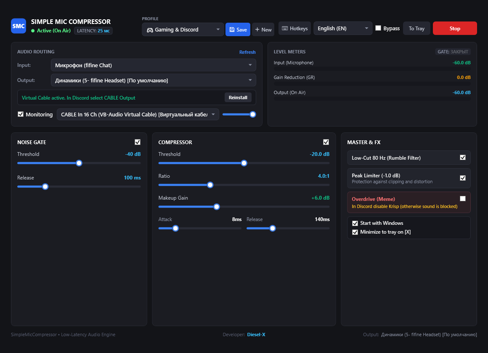
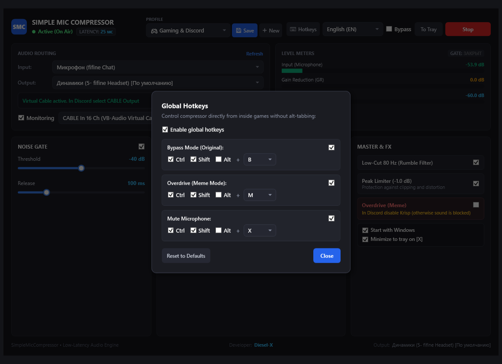

# 🎙️ SimpleMicCompressor

  <b>Language / Язык:</b>
   
  <a href="README_RU.md">🇷🇺 Русский</a> &nbsp;|&nbsp; 
  <b>🇬🇧 English</b>

  

  
  
  
  
  
  

**SimpleMicCompressor** is an ultra-fast real-time system microphone audio processor designed for **Discord**, **streaming**, and **competitive games** (CS2, Valorant, Apex Legends, Warzone). It evens out voice volume dynamics, removes mouse clicks and background hum, dampens loud screaming, and protects against digital clipping with zero impact on gaming FPS.

**Version:** `1.1`

---

## 📦 Two Editions Available

| Parameter | 🎨 SimpleMicCompressor (GUI) | ⚡ SimpleMicCompressor Light (Rust) *(Experimental)* |
| :--- | :--- | :--- |
| **Status & Stack** | Primary edition (C# / .NET 8 / WPF) | **Experimental build (Rust)** |
| **User Interface** | Full dark GUI, real-time VU meters & visual indicators | **No GUI** *(runs silently in Windows system tray)* |
| **RAM Consumption** | ~15–25 MB (background) | **~3–5 MB RAM** *(ultra-low footprint)* |
| **CPU Usage** | < 0.1% (0.0% in tray) | **0.0% CPU** |
| **Preset Management**| Sliders, graphs, 1-click custom profile creation | Shared `mic_compressor_config.json` |
| **VB-Cable Setup** | 1-click built-in installer & repair tool | Uses existing virtual cable |
| **Binary Size** | ~850 KB (Single-File) | **~529 KB** (Standalone binary) |
| **Download Release** | [📥 **GitHub Releases**](https://github.com/Diesel-x/SimpleMicCompressor/releases) | [⚡ **GitHub Releases**](https://github.com/Diesel-x/SimpleMicCompressor/releases) |

---

## ⚡ Why not OBS Studio or Voicemeeter?

* **RAM:** ~3–5 MB (Rust) / ~20 MB (GUI) vs **~500+ MB** for OBS Studio.
* **CPU & GPU:** 0.0% CPU load and **0% GPU** usage (OBS renders a full video compositor scene even for mic processing alone).
* **Latency:** **~20–25 ms** end-to-end WASAPI audio buffer — audio remains in perfect sync with speech.
* **Zero Micro-Stutters:** Completely avoids dips in 1% Low FPS in competitive esports titles.

---

## 🚀 Quick Start in 1 Minute

1. Download either edition from the [Releases page](https://github.com/Diesel-x/SimpleMicCompressor/releases):
   * **SimpleMicCompressor.exe** (recommended: with full dark GUI)
   * **SimpleMicCompressor_Light.exe** (experimental headless build — controlled via tray and hotkeys)
2. Launch the application:
   * **Input:** Select your physical microphone.
   * **Output:** Select **CABLE Input (VB-Audio Virtual Cable)**.
   * *(If VB-Cable is not installed, the GUI edition can download and install it in 1 click)*.
3. In **Discord**, **Telegram**, or in-game settings:
   * Select your input device: **CABLE Output (VB-Audio Virtual Cable)**.
   * Disable Discord's Krisp / Automatic Gain Control (AGC) for pristine natural sound.

  

---

## ⌨️ Global Hotkeys

Operates seamlessly across fullscreen games without needing to `Alt+Tab`:

| Action | Default Hotkey | Description |
| :--- | :--- | :--- |
| **Bypass** | `Ctrl + Shift + B` | Instantly bypasses DSP chain and transmits dry audio |
| **Meme Mode** | `Ctrl + Shift + M` | Toggles the infamous distorted mic overdrive sound |
| **Mute** | `Ctrl + Shift + X` | Instant zero-latency DSP hardware mute with tray badge |

  

---

## 🛠️ Studio DSP Signal Chain

1. **Low-Cut 80 Hz** — 2nd-order Butterworth filter: cuts keyboard thumps, table vibration, and fan hum.
2. **Noise Gate** — Smooth gate with 60ms hold time and hysteresis: silences room background noise without clipping word endings.
3. **Dynamic Compressor** — Balances voice dynamics (quiet whispers become clear and audible, screams are comfortably controlled).
4. **Fast Limiter (-1.0 dBFS)** — Brickwall limiter with soft saturation curve: completely eliminates digital distortion.
5. **Meme Mode** — Fun crushed audio overdrive effect for gaming banter in Discord.

---

## 📄 License & Credits

* **Author:** [Diesel-X](https://github.com/Diesel-x)
* **Project:** [SimpleMicCompressor](https://github.com/Diesel-x/SimpleMicCompressor)
* **License:** [MIT License](LICENSE)
