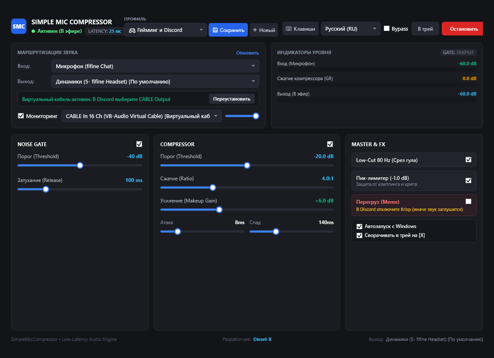
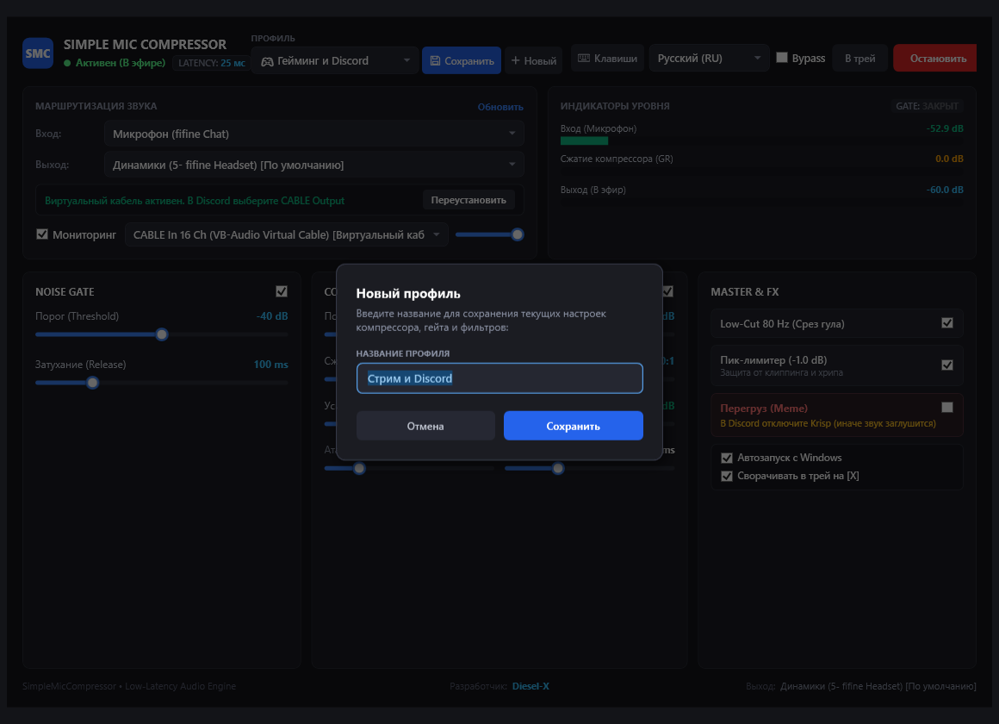
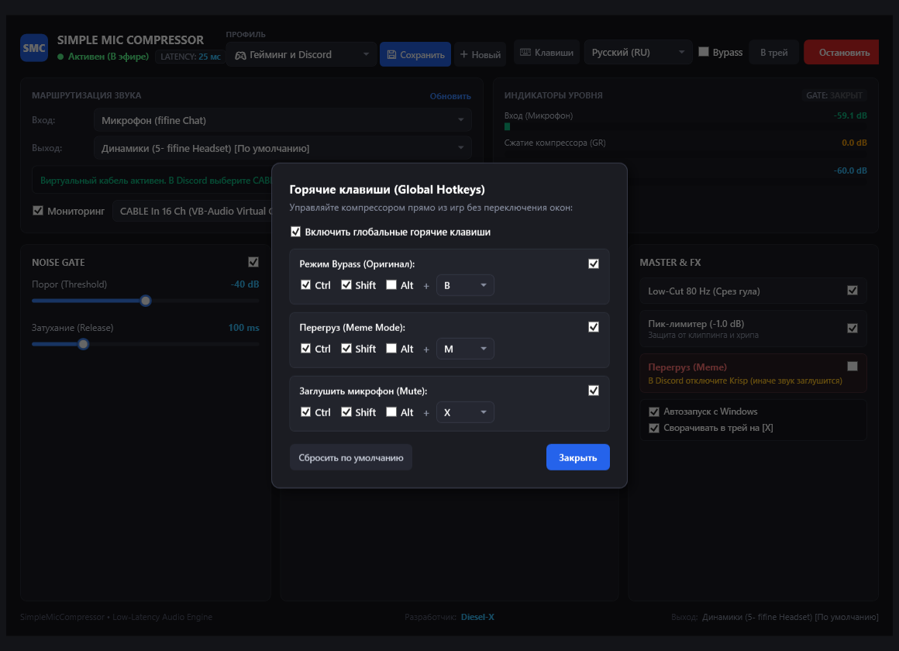

# 🎙️ SimpleMicCompressor

  <b>Language / Язык:</b>
   
  <b>🇷🇺 Русский</b> &nbsp;|&nbsp; 
  <a href="README.md">🇬🇧 English</a>

  

  
  
  
  
  
  

**SimpleMicCompressor** — системный процессор микрофона в реальном времени для **Discord**, **стримов** и **соревновательных игр** (CS2, Valorant, Apex, Warzone). Выравнивает громкость голоса, срезает клики мыши и гул, предотвращает оглушающие крики и защищает от клиппинга с нулевым влиянием на FPS.

**Автор:** [Diesel-X](https://github.com/Diesel-x)  
**Репозиторий:** [github.com/Diesel-x/SimpleMicCompressor](https://github.com/Diesel-x/SimpleMicCompressor)  
**Версия:** `1.0 Release`

---

## 📦 Две редакции на выбор

| Параметр | 🎨 SimpleMicCompressor (GUI) | ⚡ SimpleMicCompressor Light (Rust) *(Экспериментальный)* |
| :--- | :--- | :--- |
| **Статус и стек** | Основная версия (C# / .NET 8 / WPF) | **Экспериментальная сборка (Rust)** |
| **Интерфейс** | Полный графический интерфейс, индикаторы уровней (VU) | **Без интерфейса** *(фоновый сервис в трее Windows)* |
| **Потребление ОЗУ** | ~15–25 МБ (в фоне) | **~3–5 МБ RAM** *(экстремально легковесный)* |
| **Нагрузка на CPU** | < 0.1% (0.0% в трее) | **0.0% CPU** |
| **Настройка пресетов** | Слайдеры, графики, создание профилей в 1 клик | Через единый `mic_compressor_config.json` |
| **Автоустановка кабеля** | Встроена в окно (1 клик) | Использует установленный кабель |
| **Размер файла** | ~850 КБ (Single-File) | **~529 КБ** (Standalone binary) |
| **Скачать релиз** | [📥 **Скачать SimpleMicCompressor.exe**](https://github.com/Diesel-x/SimpleMicCompressor/releases/download/v1.0/SimpleMicCompressor.exe) | [⚡ **Скачать Light (Rust)**](https://github.com/Diesel-x/SimpleMicCompressor/releases/download/v1.0/SimpleMicCompressor_Light.exe) |

---

## ⚡ Преимущества перед OBS Studio и Voicemeeter

* **RAM:** ~3–5 МБ (Rust) / ~20 МБ (GUI) против **~500+ МБ** у OBS Studio.
* **CPU:** 0.0% загрузки процессора и **0% GPU** (OBS рендерит видеосцену даже для одного микрофона).
* **Задержка:** **~20–25 мс** сквозного буфера WASAPI — звук не отстает от губ.
* **Никаких фризов:** Нулевое влияние на 1% Low FPS в соревновательных шутерах.

---

## 🚀 Быстрый старт за 1 минуту

1. Скачайте любую из редакций из [раздела релизов (v1.0)](https://github.com/Diesel-x/SimpleMicCompressor/releases/tag/v1.0):
   * [**SimpleMicCompressor.exe**](https://github.com/Diesel-x/SimpleMicCompressor/releases/download/v1.0/SimpleMicCompressor.exe) (рекомендуется: с графическим интерфейсом)
   * [**SimpleMicCompressor_Light.exe**](https://github.com/Diesel-x/SimpleMicCompressor/releases/download/v1.0/SimpleMicCompressor_Light.exe) (экспериментальная версия без интерфейса — управляется через системный трей и хоткеи)
2. Запустите программу:
   * **Вход:** выберите ваш физический микрофон.
   * **Выход:** выберите **CABLE Input (VB-Audio Virtual Cable)**.
   * *(Если кабеля нет, версия GUI установит его в 1 клик по кнопке)*.
3. В **Discord**, **Telegram** или **игре**:
   * Выберите микрофон: **CABLE Output (VB-Audio Virtual Cable)**.
   * Выключите встроенный Krisp/AGC в Discord для максимальной чистоты голоса.

  

---

## ⌨️ Глобальные горячие клавиши (Hotkeys)

Работают прямо поверх любых полноэкранных игр без сворачивания (`Alt+Tab`):

| Действие | Хоткей по умолчанию | Описание |
| :--- | :--- | :--- |
| **Байпас (Bypass)** | `Ctrl + Shift + B` | Мгновенно отключает эффекты, пропуская чистый микрофон |
| **Перегруз (Meme Mode)** | `Ctrl + Shift + M` | Включает мемный звук «уничтоженного микрофона» |
| **Заглушить (Mute)** | `Ctrl + Shift + X` | Аппаратный мгновенный мут звука с индикацией |

  

---

## 🛠️ Архитектура обработки звука (DSP Chain)

1. **Low-Cut 80 Hz** — 2-полюсный Butterworth-фильтр: отсекает вибрации стола, гул вентиляторов и стук по клавишам.
2. **Noise Gate** — мягкий гейт с удержанием (Hold 60ms) и гистерезисом: тишина между словами, окончания не съедаются.
3. **Dynamic Compressor** — выравнивает громкость (тихий шепот звучит разборчиво, громкие крики удерживаются).
4. **Fast Limiter (-1.0 dBFS)** — кирпичный лимитер с мягким насыщением: полностью исключает хрип и клиппинг.
5. **Meme Mode** — забавный овердрайв для троллинга в Discord.

---

## 📄 Лицензия и авторство

* **Автор:** [Diesel-X](https://github.com/Diesel-x)
* **Проект:** [SimpleMicCompressor](https://github.com/Diesel-x/SimpleMicCompressor)
* **Лицензия:** [MIT License](LICENSE)
